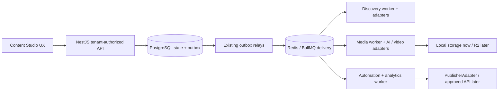

# Target architecture — preserve the modular monolith

## Boundaries

Frontend owns presentation, derived lifecycle labels and deliberate editorial actions. Nest owns authorization, validation, transactions and workflow requests. Discovery/scoring is preserved. AI content remains source-grounded with exact comment quotes, moderation/rights gates and current providers. Media work remains outside HTTP request handlers. There is one application database, one auth system and the existing queues/workflow engine.

## Stable interfaces

- Video rendering: retain `CompositionInput`, progress, output metadata and `RenderControl` (AbortSignal/deadline). A small `VideoRenderProvider.render(input, outputPath, onProgress, control)` boundary delegates to the existing Remotion renderer by default. Alternative providers must return equivalent validated dimensions/codecs and honor cancellation or explicitly report unsupported capabilities. They do not own production state/retries.
- Publishing: retain `contracts/publisher-adapter.ts` and reconcile ambiguous remote uploads by durable publication/attempt IDs. Provider validation, capabilities, publish, reconcile and permitted metrics remain behind the adapter. Existing mocks are development-only, not a production substitute.
- Storage: current authenticated immutable LocalObjectStore remains operational. Target R2 adapter must preserve workspace keys/checksums, private access, retention/takedown and short-lived media access. No R2 credentials/bucket are necessary for Milestone 1, and no duplicate media database is introduced.
- Product read model: a bounded, tenant-scoped content view joins existing source/candidate/latest production/video/publication records. Lifecycle is derived, not a second state machine. Query inputs are Zod-validated and tested for foreign IDs/cursors. Existing mutation routes remain authoritative.

## Lifecycle projection

| Product state | Existing durable evidence |
|---|---|
| DISCOVERED | Imported/scored post, candidate not yet approved |
| SELECTED | Approved candidate, no production work yet |
| SCRIPTING | Script-only/early production or saved draft ready for explicit render |
| RENDERING | VIDEO_RENDER, MEDIA_VALIDATION or STORAGE_UPLOAD in progress |
| REVIEW | Rendered video with PENDING review |
| APPROVED | Video review APPROVED |
| SCHEDULED | Actual existing publication scheduled/queued/uploading/processing record |
| PUBLISHED | Actual published record; mock records must remain labeled simulation |
| FAILED / CANCELLED | Latest operation failed/cancelled; retain error code and valid next action |

Rights, score, provider access and safety blocks are displayed alongside state and always enforced by existing API/worker gates. Do not infer publication from an approved video or infer consent from a public URL.

## Draft before render

Add an additive SCRIPT_ONLY mode to the existing production envelope and reuse script checkpoints, source grounding, leases, outbox and attempt fencing. It completes without TTS/render/output assets. Add an authorized render-from-story request using the latest saved immutable version and prior validated production settings. Existing CREATE/REGENERATE/AUDIO_ONLY/RENDER requests remain compatible; no database enum migration is needed for the JSON input mode.

## Deferred integration work

OAuth encrypted references/refresh/revocation, real publisher reconciliation, R2, video-background ingestion/mixing, precise Vietnamese alignment, paid-provider budget admission, distributed limiter/production observability and full workflow reclaim remain separate scoped work. Postiz/Postmill source is reference-only pending a specific license-compliance review. Do not import their Prisma schemas, auth, Temporal/Inngest engines or broad dependency trees.
